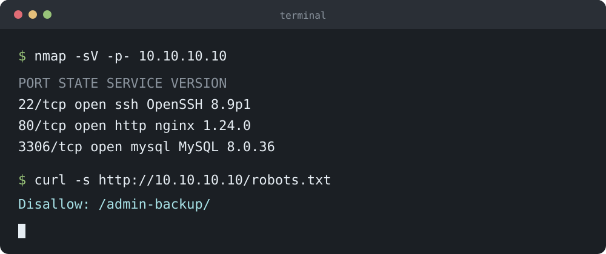
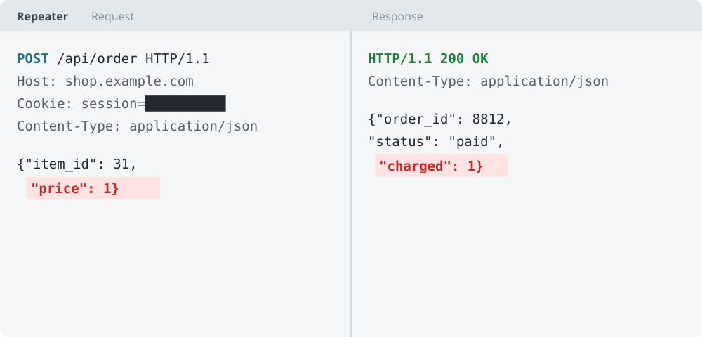
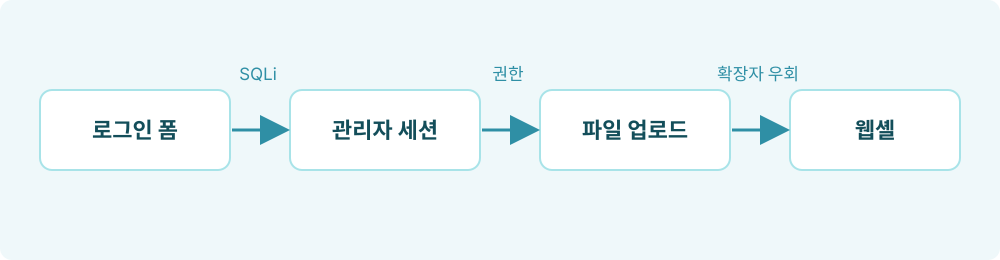
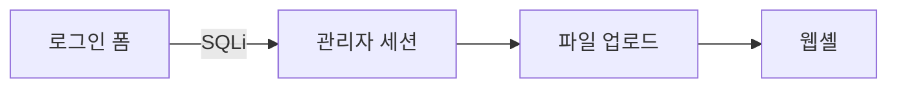

글 쓸 때 참고용. 각 항목마다 **작성법**과 **결과**를 같이 둔다.
이 파일 자체가 예시라서 `_content/posts/261015_markdown-guide/post.md`를 열어서 보면 더 빠르다.

## 글 앞부분 설정 (front matter)

파일 맨 위 `---` 사이에 쓴다.

```yaml
---
title: "대회명 - 문제명"
date: 2026-10-15 21:00:00 +0900   # 미래 시각이면 글이 안 보임
categories: [CTF]                 # 큰 분류 1개
tags: [web, sqli]                 # 세부 키워드 여러 개 (소문자 권장)
description: "홈 목록에 보일 한 줄 요약"
image: assets/cover.png           # 선택: 목록 썸네일 + 글 맨 위 이미지
pin: true                         # 선택: 목록 맨 위 고정
math: true                        # 선택: 수식 사용
mermaid: true                     # 선택: 다이어그램 사용
toc: false                        # 선택: 오른쪽 목차 끄기
---
```

## 제목

```markdown
## 큰 제목
### 중간 제목
#### 작은 제목
```

`#` 하나짜리는 글 제목(`title`)과 겹치므로 본문은 `##`부터 쓴다.
`##`, `###`이 오른쪽 목차에 나온다.

## 글자 꾸미기

```markdown
**굵게**, *기울임*, ~~취소선~~, `인라인 코드`, <kbd>Ctrl</kbd> + <kbd>C</kbd>
```

**굵게**, *기울임*, ~~취소선~~, `인라인 코드`, <kbd>Ctrl</kbd> + <kbd>C</kbd>

## 목록

```markdown
- 순서 없는 목록
  - 들여쓰기 2칸이면 하위 항목

1. 순서 있는 목록
2. 두 번째

- [x] 끝난 일
- [ ] 남은 일
```

- 순서 없는 목록
  - 들여쓰기 2칸이면 하위 항목

1. 순서 있는 목록
2. 두 번째

- [x] 끝난 일
- [ ] 남은 일

## 링크

```markdown
[보여줄 글자](https://owasp.org)
<https://owasp.org>
[다른 글로](/posts/markdown-guide/)
```

[보여줄 글자](https://owasp.org), <https://owasp.org>

글 주소는 `/posts/파일이름에서-날짜-뺀-부분/` 형식이다.

## 코드 블록

언어 이름을 붙이면 색이 입혀진다. `python`, `bash`, `javascript`, `http`, `sql`, `c`, `yaml`, `text` 등.

````markdown
```python
import requests
r = requests.get("http://target/")
```
````

```python
import requests

r = requests.get("http://target/login", params={"id": "admin' -- "})
print(r.status_code, r.text[:200])
```

### 파일 이름 붙이기

````markdown
```python
print("flag")
```
{: file="solve.py" }
````

```python
from pwn import *

p = remote("chall.example.com", 31337)
p.sendline(b"A" * 40 + p64(0x401196))
p.interactive()
```
{: file="solve.py" }

### 줄 번호 없애기

명령어나 출력처럼 줄 번호가 필요 없을 때.

````markdown
```bash
nmap -sV 10.10.10.10
```
{: .nolineno }
````

```bash
nmap -sV -p- 10.10.10.10
```
{: .nolineno }

### HTTP 요청

```http
POST /api/order HTTP/1.1
Host: shop.example.com
Content-Type: application/json

{"item_id": 31, "price": 1}
```

## 안내 상자 (Chirpy 전용)

인용문(`>`) 아래 줄에 종류를 붙인다.

```markdown
> 알아두면 좋은 것
{: .prompt-tip }
```

> `tip`: 알아두면 좋은 것
{: .prompt-tip }

> `info`: 참고 정보
{: .prompt-info }

> `warning`: 주의할 점
{: .prompt-warning }

> `danger`: 하면 안 되는 것. 예: 허가 없는 대상에 테스트 금지
{: .prompt-danger }

종류를 안 붙이면 그냥 인용문이 된다.

> 일반 인용문

## 표

```markdown
| 항목 | 내용 | 비고 |
| :--- | :---: | ---: |
| 왼쪽 정렬 | 가운데 | 오른쪽 |
```

| 항목 | 내용 | 비고 |
| :--- | :---: | ---: |
| 대회 | 예시 CTF | 2026 |
| 분야 | Web | 500점 |

`:---` 왼쪽, `:---:` 가운데, `---:` 오른쪽 정렬.

## 이미지

이미지는 글 폴더 안의 `assets/`에 넣고 `assets/파일이름`으로 쓴다.
이 글의 예시 이미지는 `_content/posts/261015_markdown-guide/assets/`에 있다.

### 기본

```markdown

```


### 설명 붙이기

이미지 바로 다음 줄에 `_밑줄로 감싼 글_`을 쓰면 이미지 아래 설명이 된다.

```markdown

_가격을 1로 바꿔 보낸 요청이 그대로 결제됨_
```


_가격을 1로 바꿔 보낸 요청이 그대로 결제됨_

### 크기 지정

`{: w="가로" }`로 표시 크기를 줄일 수 있다. 다이어그램처럼 작게 보여도 되는 이미지에 쓴다.

```markdown
{: w="600" }
_로그인 우회부터 웹셸까지_
```

{: w="600" }
_로그인 우회부터 웹셸까지_

영상(mp4)도 같은 폴더에 넣고 이렇게 쓴다. 소리 없이 자동 반복 재생된다.

```html
<video class="pf-video" src="assets/demo.mp4" autoplay loop muted playsinline></video>
```

> 스크린샷에 쿠키, 토큰, 실제 도메인이 보이면 가리고 올린다. 위 Burp 예시의 쿠키처럼.
{: .prompt-warning }

### 대표 이미지 (썸네일)

front matter에 `image`를 쓰면 홈, 태그 목록 오른쪽에 썸네일로 나오고 글 맨 위에도 크게 나온다.
이 글 맨 위 이미지와 홈 목록의 썸네일이 그 예시다.

```yaml
image: assets/cover.png
```

설명(alt)까지 쓰려면:

```yaml
image:
  path: assets/cover.png
  alt: "Burp Suite 요청 화면"
```

가로가 긴 이미지(4:3이나 16:9)가 썸네일로 잘 나온다. 썸네일에서는 가운데 기준으로 잘린다.

## 파일 경로 표시

```markdown
`/etc/passwd`{: .filepath }
```

`/etc/passwd`{: .filepath } 처럼 경로 모양으로 보인다.

## 각주

```markdown
SQL 인젝션은 오래된 취약점이다[^1].

[^1]: OWASP Top 10, A03 Injection.
```

SQL 인젝션은 오래된 취약점이다[^1].

## 수식

front matter에 `math: true`가 있어야 한다.

```markdown
$$
P(\text{collision}) \approx 1 - e^{-n^2 / 2N}
$$
```

$$
P(\text{collision}) \approx 1 - e^{-n^2 / 2N}
$$

문장 안에서는 `$$ x^2 $$`처럼 쓴다: $$ x^2 + y^2 = z^2 $$

## 다이어그램 (Mermaid)

front matter에 `mermaid: true`가 있어야 한다. 공격 흐름 정리할 때 쓸 만하다.

````markdown

````


## 접기

긴 출력이나 전체 코드를 접어둘 때.

```html
<details>
<summary>전체 출력 보기</summary>

여기에 긴 내용. 위아래 빈 줄이 있어야 Markdown이 적용됨.

</details>
```

<details>
<summary>전체 출력 보기</summary>

```text
PORT     STATE SERVICE VERSION
22/tcp   open  ssh     OpenSSH 8.9p1
80/tcp   open  http    nginx 1.24.0
3306/tcp open  mysql   MySQL 8.0.36
```

</details>

## 구분선

```markdown
---
```

---

## 자주 하는 실수

- 줄바꿈: 줄 끝에서 엔터 한 번은 이어진 문장으로 붙는다. 문단을 나누려면 빈 줄을 하나 넣는다.
- 목록, 코드 블록, 표 앞뒤에는 빈 줄을 둔다.
- 코드 블록 안에 ```` ``` ````를 보여줘야 하면 바깥을 ```` ```` ````(4개)로 감싼다.
- `date`가 지금보다 미래면 글이 안 보인다.
- front matter 값에 콜론(`:`)이 있으면 큰따옴표로 감싼다.

[^1]: OWASP Top 10, A03 Injection.
