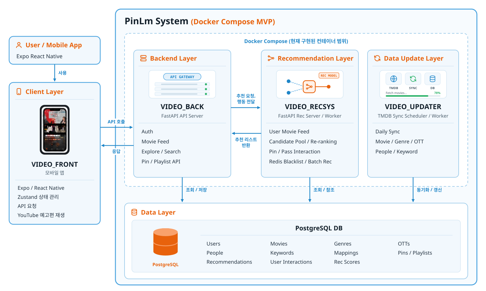

## 1 문제점 및 해결방안
1. 넷플릭스 증후군 : OTT 사용자의 약 50%  **볼 컨텐츠 찾는데 어려움**을 느낀다.
  - 사용자 정보 기반 가중치를 부여해 사용자 맞춤 추천 리스트를 생성 한다.
2. 콘텐츠 파편화 : 여러 채널로 흩어진 콘텐츠로 인해 사용자 경험의 단절
  - 구독한 OTT 기준으로 영화 필터링
3. 비용 만족도 : 다중 OTT 구독 비용 대비 낮은 콘텐츠 이용 만족도
  - 제공중인 OTT 바로가기 제공
4. 탐색 UX 문제 : 너무 많은 콘텐츠로 인한 집중력 분산
  - **쇼츠형 탐색 UI**로 빠르고 쉽게 탐색

## 2 명세서

<video class="pf-video" src="assets/demo.mp4" poster="assets/demo-poster.jpg" autoplay loop muted playsinline></video>
_온보딩부터 추천 피드까지_

## 2-1 [기능 명세서](https://app.notion.com/p/337e99071fcd807a917fc7340d83acb6) 
1. 쇼츠형태로 사용자가 쉽고 빠르게 몰입할수 있도록 유도함
2. 핀터레스트의 핀 기능과, 틴더의 스와이프 기능에 영감을 받아 **[핀 / 패스 / 중립]** 을 선택 할수 있도록 하였다. 
  - 핀 : 오른쪽 스와이프 or 하트 버튼 클릭
  - 패스 : 왼쪽 스와이프 or x 버튼 클릭
  - 중립 : 둘다 선택 안하고 그냥 내릴 경우
3. 영화 상세보기를 누르면 해당 영화 설명, 배우, 감독 정보와 상영중인 OTT 정보를 한눈에 볼수 있음
4. 플레이리스트에 저장해두고 커뮤니티에서 자신의 플레이리스트를 공유가능 : 스포티파이 플레이리스트 공유 기능 참조
5. 커뮤니티를 만들어 사용자간의 영화 리뷰 혹은 다른 사용자의 플레이리스트를 서로 공유

## 2-2 [API 명세서](https://app.notion.com/p/2dce99071fcd80a88d85fece24e0cad2?v=2dce99071fcd8087b070000c6c63efa6), [DB 명세서](https://app.notion.com/p/SSACSSACGAMJA-2a5e99071fcd8063b090c64bd1211c72?p=33ee99071fcd80deb3f4dc1f6d42d67c&pm=s)
- REST API 기반의 웹 프로젝트를 하기전 client-server 간의 규약을 정의 하여야 한다. 이외에도 client의 정보, 행동 패턴등을 저장하기 위한 테이블 구조도 정의 되어야한다. 
- 14개의 카테고리로 나눴으며 총 53개의 API가 명세 되어있으며, 자세한 사항은 제목에 참조된 링크를 통해 확인할수 있다.

## 3. 아키텍쳐

_PinLm 시스템 구성 (Docker Compose MVP)_

## 3-1 기술 스택
Python - fastAPI를 적용하였다. 제일 중요했던게 빠른 MVP 개발이었고, 가장 잘 사용할 수 있는 언어를 사용하고자 하였다. FastAPI의 경우 비동기, 동기 모두 지원하고 속도가 빠르다는 장점이 있었다. 또한 Python을 씀으로써 추후 알고리즘 부분을 적용할때 확장성 면에서도 충분한 이점을 가진다 판단하여 채택하였다.

PostgreSQL - 많은 서비스와 기능, API들을 제공해주고 Pin/Pass 동작, 추천을 위한 데이터 참조 등에서 CRUD 작업이 활발하게 이루어짐 그렇기 때문에 견고하고 체계적인 스키마가 필요했다. MySQL도 가능했으나, 많이 사용한다 해서 사용해보고 싶었고 ORM 관련해서도 기능을 제공했기 때문에 사용하지 않을 이유는 없었다.

Redis - noSQL인데 단기 학습 데이터 저장용 캐시로써 설정함, 이미 많은 APi를 제공하고 그 안에서 수 많은 참조가 이루어질 것이고, 조금이나마 부담을 줄이기 위해서 설정해둔 장치

Gihub - 형상 관리, 버전 관리, log 추적 용

Notion - 업데이트, 정보 수집, 전달 등 관리용

Discord - 온라인 미팅

Figma - PPT 준비, 앱 디자인

### 3-1. Frontend
1. React Native

### 3-2. Backend
1. FastAPI
  - 빠른 개발, 비동기 처리 등 python 기반으로 ML 적용도 가능
2. PostgreSQL
3. Redis : 후보군 추출할때 조회용으로 사용, DB 부담 감소 위한 캐시용 
4. Docker

### 3-3. Backend Layer
1. API Layer : 사용자에게 받은 요청을 처리하는 부분
2. Recommaendation Layer : 사용자 마다 영화 추천 리스트 생성
3. Data Update Layer : TMDB API에서 업데이트 되는게 있으면 자동으로 DB 업데이트