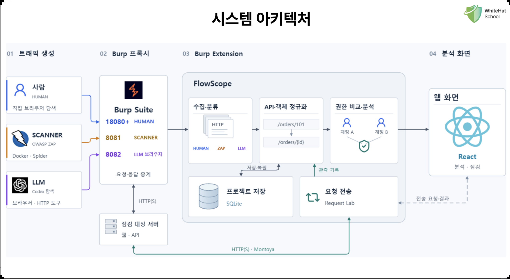

## 1. 아키텍쳐

## 1-1 설명

**[트래픽 생성]**

검사하는 주체를 의미한다. 해당 API, 객체(데이터)에는 어떤 소스가 접근했는지 구분한다. 사람은 18080 부터 시작해서 user 생성마다 1씩늘어난다. 스캐너는 8081, LLM은 8082로 프록시 포트를 통해 구분한다. 이렇게 설정한데에는 역사가 있다. 기존에는 8080, 8081, 8082로 설정하고 사람 트래픽을 USER 마다 구분하기 위해 해당 유저로 로그인한 후 트래픽 캡쳐를 하도록 하였다. 이렇게 했을때 다음 트래픽에 관하여 하나라도 다른 경우 트래픽 수집을 하지 않았다. 이런 불편함을 제거하고자 [시작] - [종료] 버튼을 두어 그 사이의 트래픽은 설정한 user로 종속되도록 하였다. 이렇게 했을때의 문제점은 사용자가 실수로 로그아웃하지않고 탐색했을때 그래프가 오염이 될수 있다는 문제점이 있고 무엇보다 지금까지의 방법론은 사용하기 불편했다. 그래서 나는 해당 부분을 Burp의 Montoya API에서 제공하는 기능을 통해 브라우저를 직접 열게 했고 그 브라우저마다 프록시를 설정하여 그래프가 오염되지 않게했고 동시에 여러 유저를 검사할수 있도록 개선하였다.

**[API 및 객체]**

API는 endpoint를 수집하게끔 하였다. 대신 모든 트래픽을 보여주게 될경우 그래프가 너무 커져버리기때문에 어느정도 필터링 작업이 필요하다고 느꼈다. 그래서 여러 논문들을 참조한 결과 공통적으로 정적자원(static/, css, jpg,...)은 필터링하는 것을 확인했다. 충분히 근거가 있었지만 혹여나 정적자원 목록이 필요한 상황이 생길수 있을것이라 판단하여 핵심 API / 전체 API 보기형태로 나누어서 전체 API 보기를 눌렀을때만 보이도록 진행하였다.

객체 부분이 가장 고민했던 부분중 하나였다. 웹사이트에는 API가 있고 그걸 이용하는 주체가 있다. 서버는 해당 API요청에 관하여 클라이언트에게 객체를 전달해주는 역할을 한다. 우리가 연구했던것은 객체를 어떤식으로 지정하느냐였다. 결론부터 말하면 객체 지정은 수동으로 하게끔 설정하였다. Public(게시판 같은거)객체에 대한 부분과 실제 IDOR인 부분이 충돌될 가능성 때문이었다. 예를들면 모든 사람이 같은 객체가 있는 엔드포인트에 접근했다 해서 이것을 Public으로 둔다면 실제 IDOR/BOLA/BFLA 일수도 있는것을 배제하는 것이기 때문에 오탐이 생길수 있다. 우리 도구는 취약점을 분석하는 보조도구로써의 정체성을 살리고자하였고 최대한 오탐을 없애는것에 목표를 두었다. 그렇게 하여 객체는 사용자가 직접 (비로그인 / USER A / USER B / ... - 계정,세션에 등록된 유저)설정하게끔 하였다.

**[정규화]**

모든 트래픽을 그대로 보여주게 될경우 발생하는 문제점으로는 그래프가 너무 많아진다는점이다. 정규화는 이러한 문제를 해결할수 있는 좋은 방법론이었다. 우리가 적용한 정규화 방식은 API 정규화, 객체 정규화 방식이 있다. 
1. API 정규화 
`http://127.0.0.1:8080/API/v1`과 같은 경로가 있다고 가정했을때 http://127.0.0.1:8080 은 Target 노드로써 맨 첫번째에 보이게 했다. 여러개의 도메인을 검사하는 경우를 고려하였다. 실제로 DNS를 쓸경우 서브 도메인별로 따로 나타나게 된다. 이후 `/API`는 1차 정규화 노드이다. Target기준으로 확인 가능한 폴더 혹은 파일을 묶는 노드이다. 1차정규화 이후 생성된 노드를 들어가면 `신원 - API - 객체(데이터)` 형태로 실제 트래픽을 보여주는 그래프가 형성되는 것을 확인할 수 있다.
2. 중복제거 
여러개의 유저로 사이트를 돌아다니다 보면 같은 경로로 보내는 요청들이 많을텐데 이것들을 유저별로 다 따로 보여주게 될경우 그래프가 커진다. 같은 경로에 한해서는 하나의 노드로 접근한 형태로 보여주게함으로써 중복을 제거하였다.
3. 객체 정규화 
이부분이 가장 고민하며 진행한 부분중 하나이다. 우리의 맨처음 접근은 자동으로 객체가 누구 소유인지 할당 해주자 였다. 이부분은 앞서 언급한 어려움이 있었기에 진행하지 않았다. 나는 중간에 개발팀에 합류했기에 맨처음 어떤식으로 개발되었는지 바로 파악하기 힘들었다. QA를 진행하던중 객체를 너무나도 못잡는것을 목격했고 어떤 문제가 있었는지 파악해보니 쓸데없는 필터링이 너무많이 들어가있었다. 조건이 몇개가 있었는데 이중 하나라도 안되면 객체로 취급안하는 그런 로직이었다. 해당 프로젝트에서 가장 중요한건 어떤 유저가 어떤 API의 객체에 접근했는지 그런게 중요했다. 그래서 객체에 대한 개념을 바꿔서 생각하여 로직을 재구성하였다. 지금까지 객체를 어떤 데이터로 보면서 게시물과 같은 데이터베이스에 저장한 나의 정보 같은 것들로써만 생각해왔던 우리는 의미를 넓혀 Endpoint 그자체를 객체로 보게끔 설정하였다. 하지만 그렇게 될경우 신원 - API 형태의 그래프가 될것이기에 객체형태를 갖는 API를 정리하였고 크게 3가지가 있었다. 집중해서 본점은 파라미터가 있냐는 것이었다. 결국 IDOR/BOLA/BFLA등 분석에서 중요한점은 입력값을 조작할수 있는부분이 있는지 확인하는 것이다. 그렇기에 3가지 경우가 가장 적합하다고 판단했고 놓치지 않고 보여줘야할 부분이라고 생각했다.
 

| 이름 | 형태 | 설명 |
| :-- | :-- | :-- | 
| Path Param | /api/{id} | 맨끝의 경로만 가변적으로 바뀌는 형태이다. 게시물의 ID같은것이 예이다. Path를 여러개로 처리하는 경우가 있을수 있다. `/playlist/{id}/items/{id}` 형태처럼 되어있는 경우 그 이상으로 나타내는 경우들도 쉽게 볼수 있는데, 그래프 가시성을 위해 최대 2단계로만 정규화 하도록 설정하였다.
| Query Param | /api/1?id=2 | 쿼리형태로 값을 받는 경우도 객체로써 지정하였다. |
| Body값 이있는 요청 (POST) | Req's body {id:1} | Body값이 있는경우는 하나의 요청을 하나의 객체로서 지정하게 했다. |

예외 : 3개의 상황 중 2개 이상 포함이 되는경우 하나의 노드로써 표현하게 했고 PATH-QUERY PARAM 노드로 표현하도록 설정하였다.
