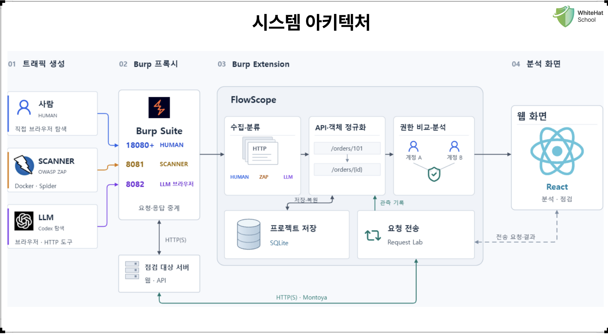

## 1. 아키텍쳐

## 1-1 설명

**[트래픽 생성]**

검사하는 주체를 의미한다. 해당 API, 객체(데이터)에는 어떤 소스가 접근했는지 구분한다. 사람은 18080 부터 시작해서 user 생성마다 1씩늘어난다. 스캐너는 8081, LLM은 8082로 프록시 포트를 통해 구분한다. 이렇게 설정한데에는 역사가 있다. 기존에는 8080, 8081, 8082로 설정하고 사람 트래픽을 USER 마다 구분하기 위해 해당 유저로 로그인한 후 트래픽 캡쳐를 하도록 하였다. 이렇게 했을때 다음 트래픽에 관하여 하나라도 다른 경우 트래픽 수집을 하지 않았다. 이런 불편함을 제거하고자 [시작] - [종료] 버튼을 두어 그 사이의 트래픽은 설정한 user로 종속되도록 하였다. 이렇게 했을때의 문제점은 사용자가 실수로 로그아웃하지않고 탐색했을때 그래프가 오염이 될수 있다는 문제점이 있고 무엇보다 지금까지의 방법론은 사용하기 불편했다. 그래서 나는 해당 부분을 Burp의 Montoya API에서 제공하는 기능을 통해 브라우저를 직접 열게 했고 그 브라우저마다 프록시를 설정하여 그래프가 오염되지 않게했고 동시에 여러 유저를 검사할수 있도록 개선하였다.

**[API 및 객체 정규화]**

